# QCC 根因分析与对策闭环：参考案例学习笔记

> 用途：作为“提升泛 ICT 领域竞品分析效率”后续根因分析、要因确认和对策拟定的长期方法参考。图片是 T# 原型绘制效率案例，只示范方法链，不是本课题的数据或根因证据。
>
> 整理日期：2026-11-10。
>
> 维护约定：每次调整本课题的鱼骨图、要因确认、对策评价或实施计划前，先回看本笔记对应环节及原图；方法可以迁移，案例内容、阈值和结论不能直接照搬。

## 一、我从这组图片中读到的完整逻辑

这不是“画完鱼骨图就得出根因”，而是把一个改善课题按证据逐步收敛：

**明确可衡量的目标与分析边界 → 按共同工作过程展开原因假设 → 逐项制定确认方法和判定标准 → 用实际结果确认或排除要因 → 汇总已确认要因 → 针对要因提出多种对策并比较 → 把选定对策落成措施、目标、责任人与时间 → 实施并复核效果。**

各工具承担不同任务，不能互相替代：

| 环节 | 回答的问题 | 主要产物 |
| --- | --- | --- |
| 目标与初步分析 | 要改善什么结果？工作沿什么过程发生？ | 有口径的目标、问题边界、共同过程顺序 |
| 鱼骨图 | 可能有哪些原因？原因可能发生在哪个过程环节？ | 候选原因结构，不是根因结论 |
| 要因确认 | 哪些候选原因在本课题中确实存在，并达到预先约定的影响标准？ | 带方法、标准、数据和判断的确认记录 |
| 要因汇总 | 哪些候选原因已通过确认？ | 精简、可追溯的已确认原因清单 |
| 对策评价与选择 | 针对已确认原因，哪个方案更值得做？ | 多个候选方案、同口径评分与选择理由 |
| 对策拟定与实施 | 谁在何时做什么，做到什么程度？ | 措施、量化目标、责任人、完成时间与验证安排 |

## 二、逐页拆解

### 1. 目标先于找原因：先对齐结果和共同过程

第 1 张先给出改善目标“使用 T# 工具的原型绘制效率提升 53%”，随后说明讨论确认了六类控件，且它们的绘制步骤一致，所以按共同绘制步骤展开分析。

这里值得迁移的不是“53%”这个数，而是两件事：

- 目标应能被核算：明确基线、目标值、计量单位、统计对象和时间范围；不能只有“提升效率”这类方向性口号。
- 原因分析的分支顺序要有课题过程依据：若多个对象共享同一操作链，就沿共同操作链找原因；若本课题不同任务过程不同，则先区分流程，不能为了图形整齐硬套一条流程。

**本课题应用提醒：**竞品分析的效率结果要按已约定的“完整分析周期、首轮关键结论可采纳率、重大返工率”分别定义口径；竞品分析时间与设计时间是并列投入，不应混为一个分母或互相冲抵。

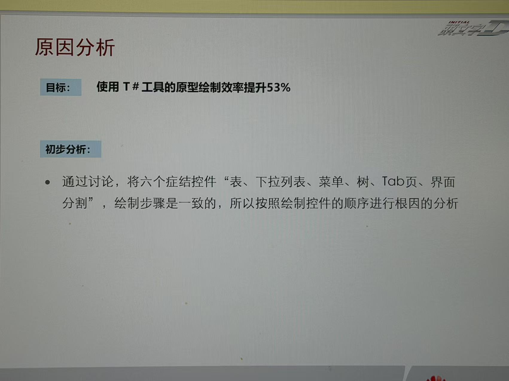

### 2. 鱼骨图是原因假设结构，不是根因结论

第 2 张把“绘制控件效率低”放在鱼头，以绘制过程中的不同因素作骨枝和小枝，并把可能原因放在具体分支上。后续的要因确认页又检验这些候选项，说明鱼骨图本身并未替代验证。

迁移到我们的分析时：

- 鱼头只放一个清楚、可观察的待解释结果；多个结果可以关联分析，但不要把数个指标堆成一句鱼头，导致每根骨头不知道在解释什么。
- 主枝可以依据真实过程、人员、工具、资料或环境归类，但不要求固定为“六大类”，也不以填满骨枝为目标。
- 小枝应能回答“它如何造成鱼头结果”。同处一条骨枝不自动构成因果关系；如果机制说不清，就拆开、改写或暂不连线。
- 末端原因要足够具体、可观察、可确认，并且原则上能对应可干预的工作条件。现象、需求、目标、解决方案、外部限制要区分，不把“低采纳”“反复修改”直接当根因，也不把“建知识库”写成原因。
- 从宽泛判断继续追问到具体环节：例如“没有明确分析支持哪项设计决策”仍可能是问题表现或中间原因；要继续检查接题时是否要求说明决策、信息是否传递到检索和输出、哪里首次偏离。

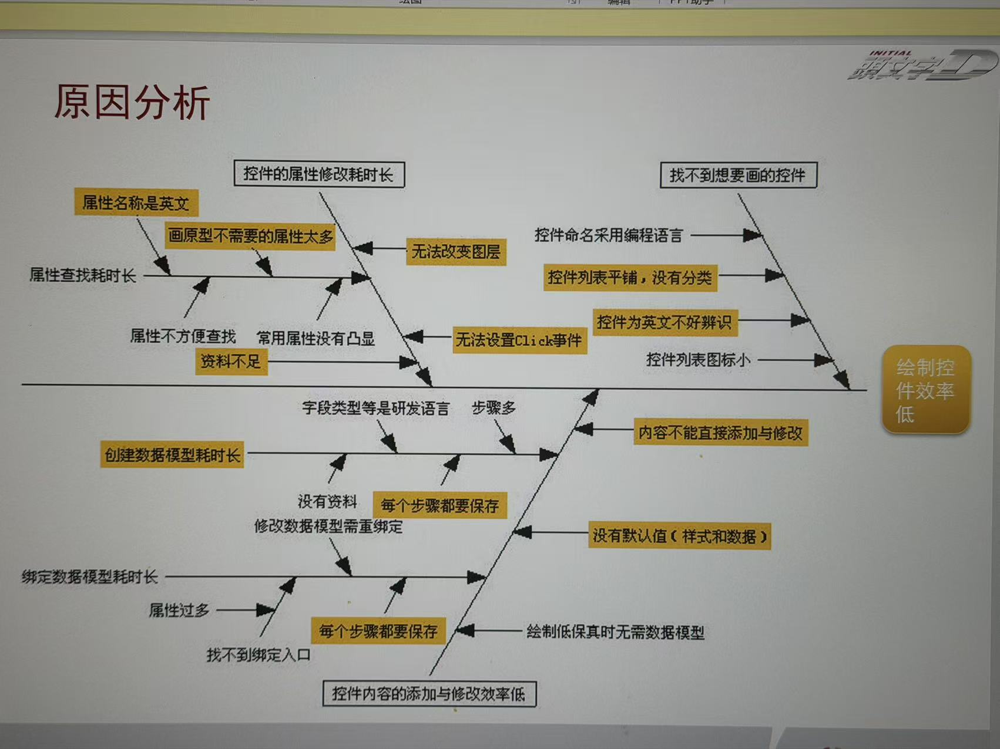

### 3. 要因确认：先定怎么查、什么结果算成立，再看数据

第 3–6 张把每条原因拆成独立确认行，使用的列包括：**原因、确认内容、确认方法、判定标准、确认结果、责任人、完成时间、影响程度、要因确认**。不同候选原因采用了不同核验方式：盘点资料覆盖、比较有无图层/默认值的操作效率、统计不可识别名称比例、统计保存对预览的影响等。

这套结构最重要的顺序是：

1. 将候选原因改写成一个可检验的问题；
2. 指定能直接观察或测量该问题的材料、样本和步骤；
3. **在查看结果前**约定门槛或比较规则；
4. 记录真实观测值，并与标准对照；
5. 给出确认、排除或暂不能判断的结论及其依据。

判定标准应能由另一个人按同一材料复核。例如“占比超过预设阈值”“同任务下耗时差超过预设比例”“某类材料覆盖了明确列出的必需项”；避免“影响较大”“经常发生”“用户觉得不方便”等未定义词。方法、标准和结果也要指向同一变量、同一对象和同一单位。

**存在不等于构成要因。**发现“有些属性是英文”只能证明现象存在；还要确认它是否让目标用户难以识别、是否超过事先标准、是否实际拖慢了目标过程。一个因素即使存在，影响低于阈值，也可能不进入要因；反之，缺数据不能写成“否”。

对我们当前材料，建议把判断状态明确区分：

- **已确认**：按预设标准取得了支持要因成立的证据；
- **未达到标准／暂不认定**：已按方法测量，但结果没有达到标准；
- **待验证**：确认工作还未完成；
- **待补证**：明确指出缺哪项数据、记录或样本才能判断。

“待补证”后必须写清要补的材料和它用于验证哪一环，不能让它成为不说明内容的兜底标签。

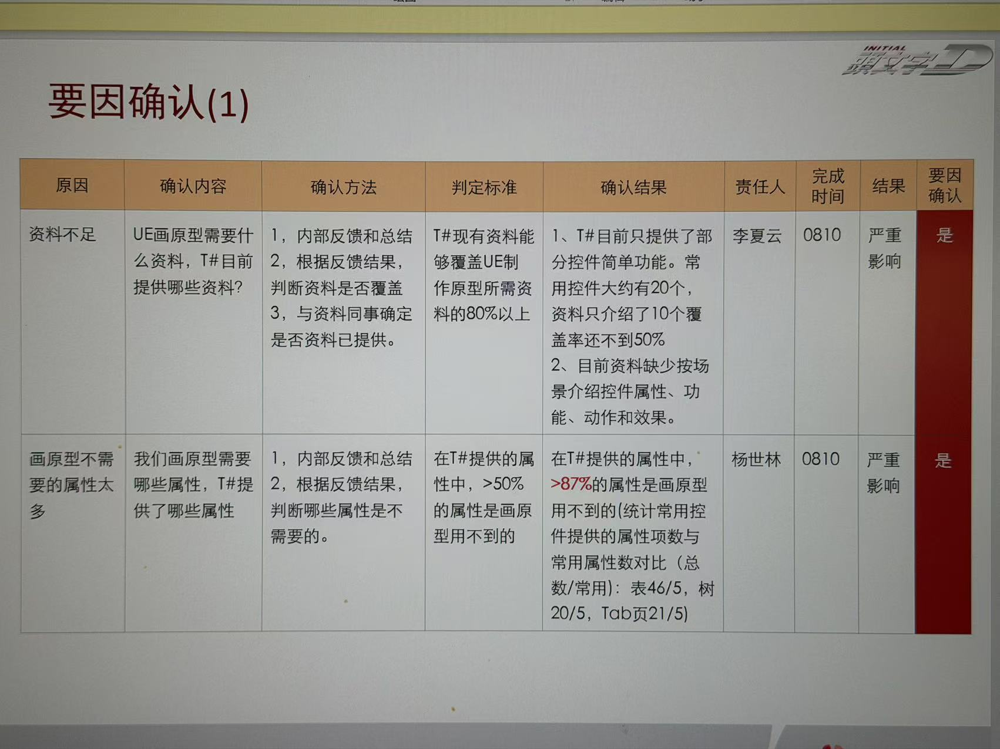

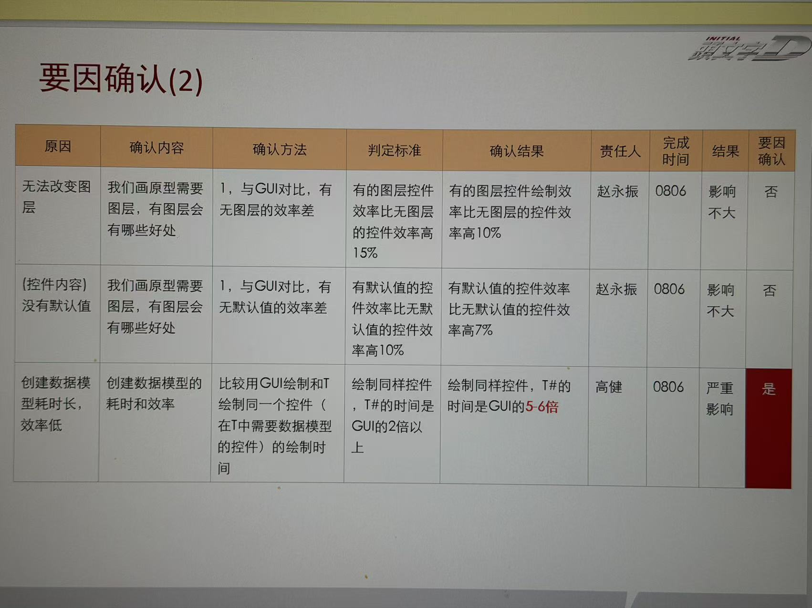

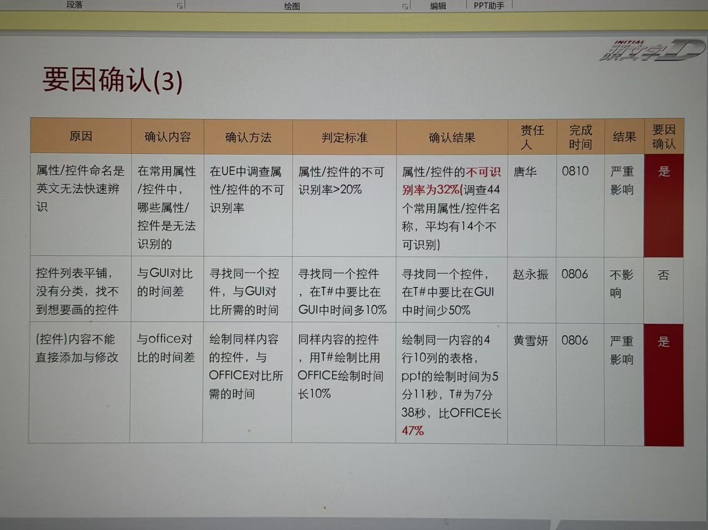

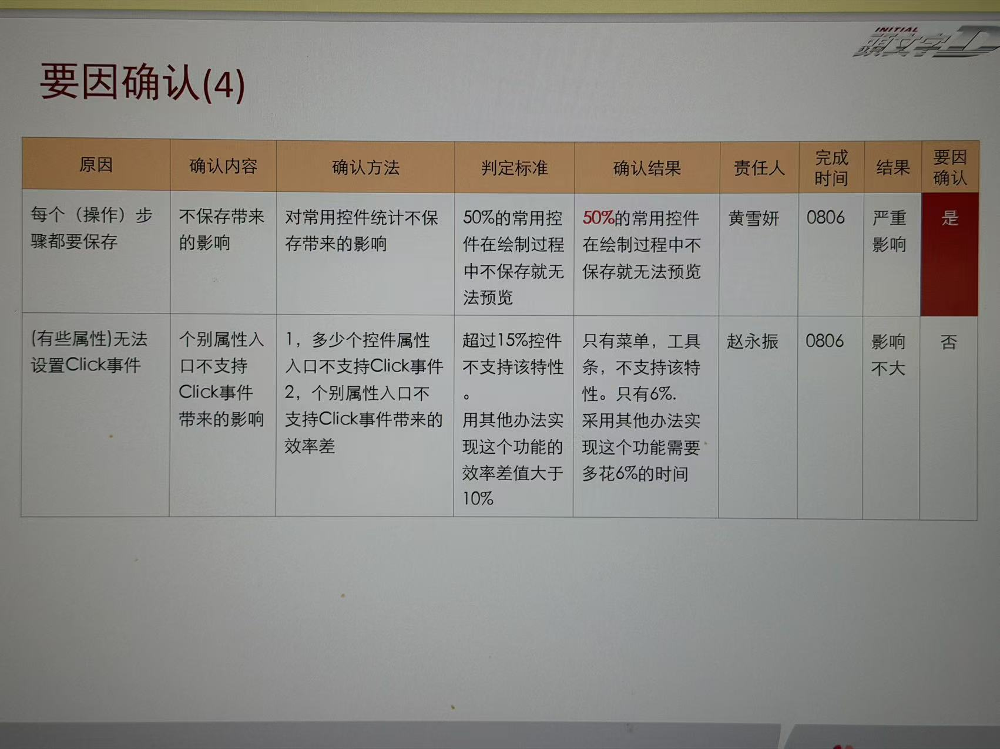

### 4. 要因汇总只保留确认通过的原因

第 7 张把前面各张表中判为“是”的原因压缩成一张清单。这一步把“候选原因空间”收敛为“后续要解决的问题”，便于对策讨论，也能防止未经确认的分支混入结论。

本案例汇总的六项是：资料不足以支持原型绘制、无关属性过多而难找目标属性、控件内容不能直接添加或修改、操作步骤需要反复保存、创建数据模型耗时、英文属性/控件名难以快速识别。它们来自这份原型工具案例，不能移植成竞品分析项目的原因。

应用时应能从汇总表回链到确认行及证据。若确认页的状态是待验证或待补证，就不应悄悄出现在“已确认要因”清单里；可以另列“尚待确认”，但必须与正式要因分开。

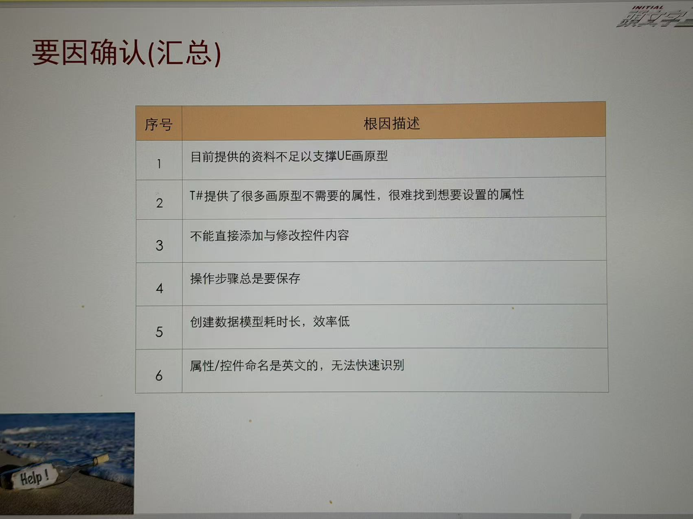

### 5. 对策评价与选择：围绕要因比较方案，不是直接跳到喜欢的方案

第 8–9 张针对不同已确认原因列出多个备选对策，并按有效性、低成本、实施性评分，汇总后标注优选、次选或不选。其逻辑是**原因 → 多个备选 → 同一评价维度 → 有理由的取舍**。

迁移时需要补强评分规则：

- 先定义各维度的评分锚点，如 1/3/5 分分别代表什么；若成本维度是“越低越好”，要明确高分代表成本更低。
- 说明各维度是否等权；若总分采用简单相加，应说明为什么等权，必要时预设权重。
- 对安全、合规、证据可信等不可被其他高分抵消的条件，设置门槛而不是并入总分。
- 记录选择理由、依赖条件和风险；总分相近时说明取舍逻辑。
- 只针对已经确认的要因选对策；对“待补证”的假设可以设计验证动作，但不要把它包装成根因解决方案。

照片里的评分表示范了比较方式，但没有充分显示评分锚点和权重依据。因此要学习“并列比较、显式选择”的结构，不应照抄表内具体分数或认为加总分天然客观。

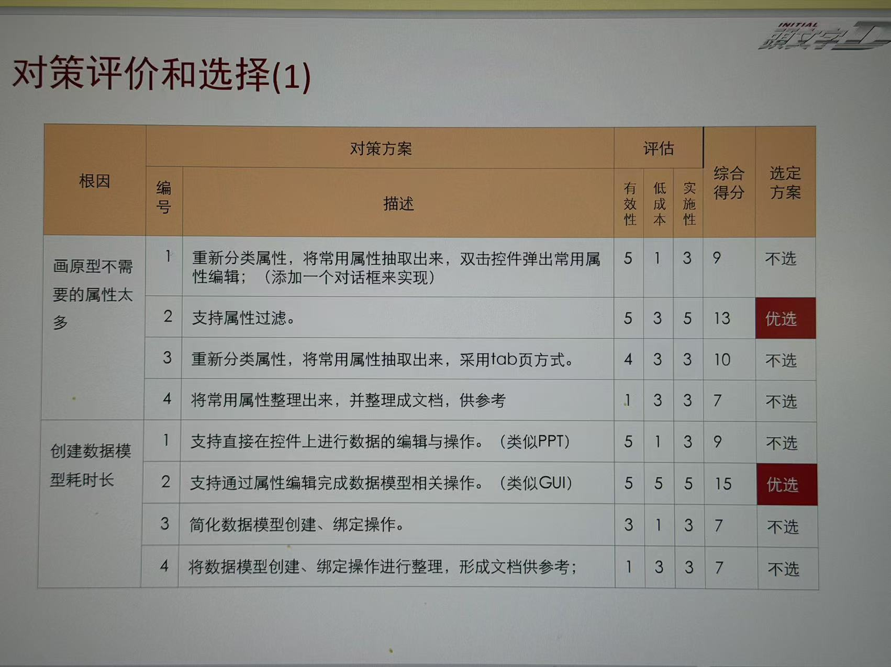

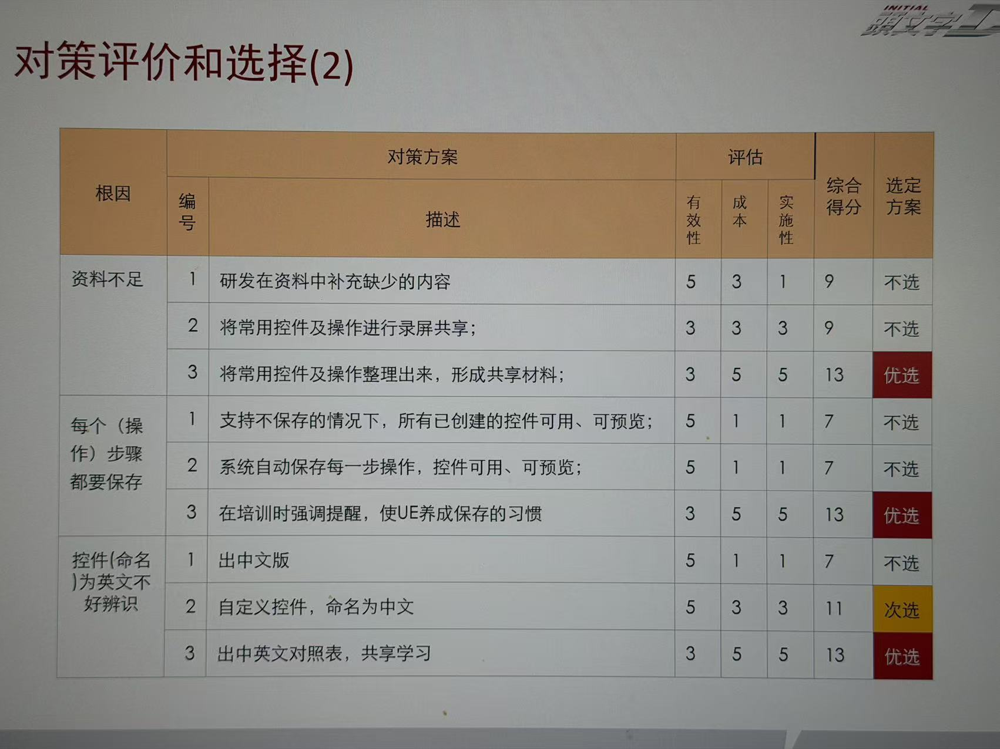

### 6. 对策拟定和实施：让责任、动作、目标闭环

第 10–11 张把选中对策继续拆成“根因、对策、措施、目标、责任人、完成时间”；第 12 张则以一个具体问题和目标呈现从根因分析、要因确认、对策选择到实施的衔接。

每项措施至少回答：

- 针对哪条**已确认**要因？
- 实际要做什么，改的是流程、工具、内容还是协作机制？
- 谁负责，何时完成，需要哪些前置条件？
- 用什么指标、样本和周期判断达标？
- 除预期收益外，是否增加了前置整理、审核、维护或培训成本？

目标应与要因和措施对应。例如“提高材料质量”不足以验收；应定义材料覆盖哪些任务、条件或证据类型，以及如何抽检。完整效率改善还要把新增的知识整理、人工核验和维护成本计入总投入，避免只减少某个局部时间，却把工作转移到别处。

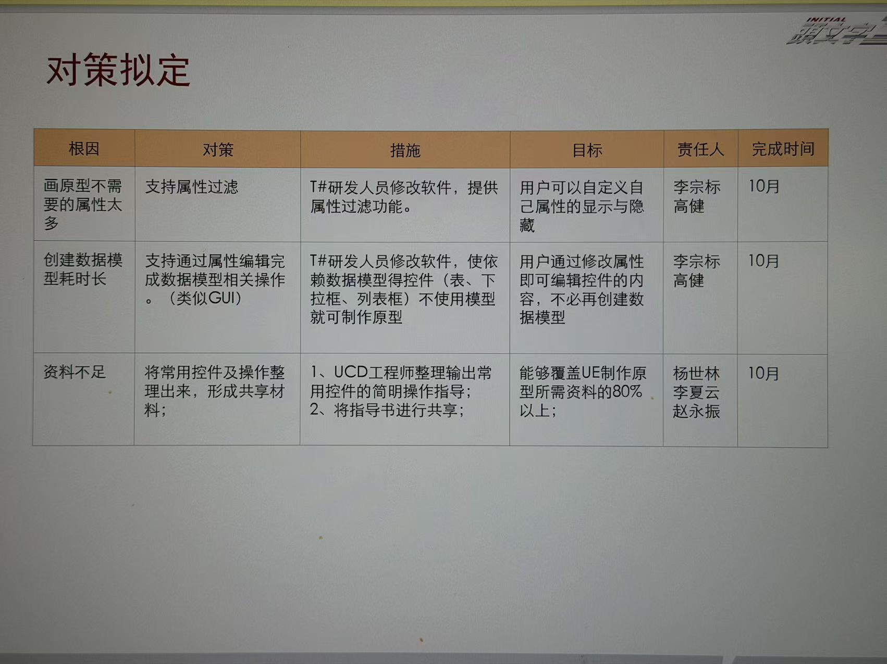

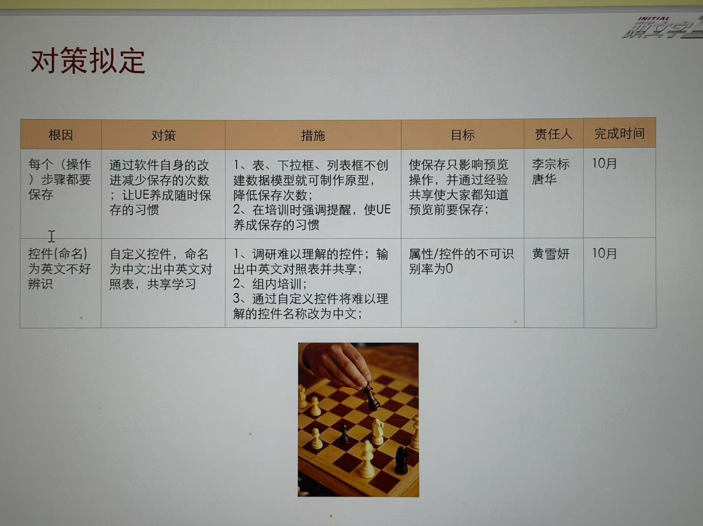

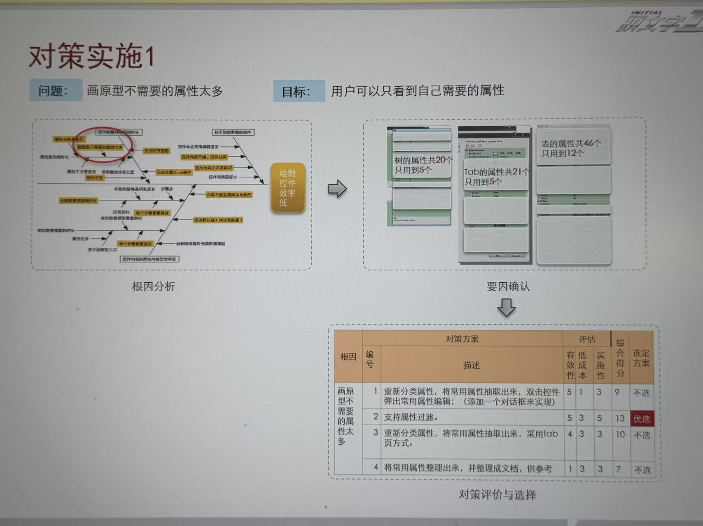

## 三、迁移到本课题的工作准则

后续任何一版材料都按这条证据链审阅：

1. **目标和口径先固定。**明确改善对象、基线、计算规则和时间范围；不得把设计时间并入竞品分析时间。
2. **先开放分析，再收敛。**鱼骨图不预设“正好六个根因”，也不因已有三个痛点就限制原因数量；从实际工作过程和机制展开。
3. **因果连接逐条审查。**每个节点说明它怎样促成上层问题；无可解释机制的箭头删除或改为待验证关系。
4. **末端原因才进入确认表。**如果一个节点仍在描述症状或宽泛中间问题，先继续追问，或把它标成中间层，不假装已经找到根因。
5. **确认规则先于结果。**确认方法和标准写具体；记录数据出处、样本、观察单位、结果与限制。
6. **结论随证据状态变化。**提出、待验证、待补证、未达标准、已确认要因分别呈现，不能把“访谈提到”直接等同于“根因成立”。
7. **对策必须追溯到要因。**每个措施能回链到一条确认记录；对策评价规则透明，并设计实施后的复测。
8. **保持图表样式稳定，优先修内容逻辑。**本组参考照片用于学习方法和证据链，不代表要照搬其视觉风格或把当前报告改成同样的表格。

## 四、原图索引

| 顺序 | 图片内容 | 文件 |
| --- | --- | --- |
| 01 | 目标与初步分析 | [`01-goal-and-initial-analysis.jpg`](efficiency-case/01-goal-and-initial-analysis.jpg) |
| 02 | 鱼骨图 | [`02-fishbone-analysis.jpg`](efficiency-case/02-fishbone-analysis.jpg) |
| 03–06 | 要因确认（4 张） | `efficiency-case/03-cause-confirmation-1.jpg` 至 `06-cause-confirmation-4.jpg` |
| 07 | 已确认要因汇总 | [`07-confirmed-causes-summary.jpg`](efficiency-case/07-confirmed-causes-summary.jpg) |
| 08–09 | 对策评价与选择（2 张） | `efficiency-case/08-countermeasure-evaluation-selection-1.jpg`、`09-countermeasure-evaluation-selection-2.jpg` |
| 10–11 | 对策拟定（2 张） | `efficiency-case/10-countermeasure-formulation.jpg`、`11-countermeasure-formulation-detail.jpg` |
| 12 | 对策实施流程 | [`12-countermeasure-implementation-flow.jpg`](efficiency-case/12-countermeasure-implementation-flow.jpg) |

图片按收到顺序保存为本地副本，原始附件文件名在提交记录和会话中可追溯；图片内容里的 T# 案例数据仅属于该参考案例。
